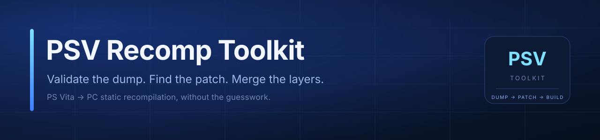
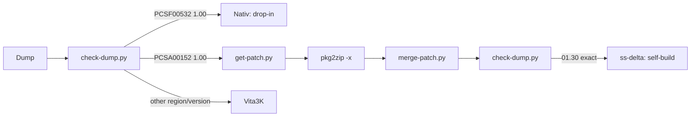

<p align="center">
  
</p>

<h1 align="center">PSV Recomp Toolkit</h1>

<p align="center">
  <em>Validate the dump. Find the patch. Merge the layers. Pick the route.</em>
</p>

<p align="center">
  <a href="https://github.com/kidnappe/psv-recomp-toolkit/actions/workflows/ci.yml"></a>
  <a href="LICENSE"></a>
  
  
  
</p>

<p align="center">
  <a href="README.md">English</a> | <a href="README.zh-CN.md">中文</a>
</p>

> **This repository ships no game data.** No game dumps, update packages, firmware, licence files, decrypted assets or compiled game code. Bring your own legally obtained copy.
>
> **This is not the recompiler.** It is the toolkit that checks whether a dump can feed one, finds the official update, and prepares the tree the recompiler expects. The recompilers themselves live in [vita-recomps/ss-delta](https://github.com/vita-recomps/ss-delta) and [Project Nativ](https://github.com/TheLostPantheon/nativ).

## Contents

- [What this is](#what-this-is)
- [Supported titles](#supported-titles)
- [Tools](#tools)
- [Requirements](#requirements)
- [Install](#install)
- [Quick start](#quick-start)
- [Full walkthrough: US Soul Sacrifice Delta to 1.30](#full-walkthrough-us-soul-sacrifice-delta-to-130)
- [Command reference](#command-reference)
- [How it works](#how-it-works)
- [Compatibility data](#compatibility-data)
- [Chinese text on the US release](#chinese-text-on-the-us-release)
- [FAQ](#faq)
- [Docs](#docs)
- [Layout](#layout)
- [Scope and legal](#scope-and-legal)
- [Contributing](#contributing)
- [Acknowledgements](#acknowledgements)
- [License](#license)

## What this is

Static recompilation tools identify a game by **the eboot's SHA-256 and `APP_VER`**, not by the folder name or the download page title. Pick the wrong region or forget the 1.30 update, and the toolchain rejects the dump after you have already installed Visual Studio, Qt and the Vulkan SDK.

This toolkit handles the four steps before that:

| Question | Tool |
|---|---|
| Which region and version is this dump, and can it be used? | `check-dump.py` |
| Where is the official update package? | `get-patch.py` |
| The dump is layered as `app/` + `patch/`; how do I merge it? | `merge-patch.py` |
| What is the Vita3K status, and is there a native pack? | `psv-lookup.py` |

Everything is standard-library Python. No `pip install`, no build step, no game data in the repo.

## Supported titles

| Title ID | Region | Vita3K | Native recompilation | Chinese |
|---|---|---|---|---|
| `PCSA00152` | US | Playable (graphics bug) | **ss-delta** — needs the 1.30 update and a self-build | ✅ Simplified / Traditional text¹ |
| `PCSF00532` | EU | Playable (graphics bug) | **Nativ** — drop-in pack | Untested |
| `PCSC00049` | JP | Playable (graphics bug) | — | Japanese |
| `PCSD00079` | Asia / HK | **Ingame +** (graphics and shader bugs) | — (a pack has to be built) | ✅ Traditional |
| `PCSA00092` | US (2013 original) | Playable | — (both projects only target Delta) | — |

> Vita3K's “Playable” is the best result across all regions. The Asia release is listed as `Ingame +` per title.

¹ The US 1.30 archive contains `_cn` and `_tw` message tables and fonts (`achievement_text_cn.msgt`, `elder_cn_font0.gxt`, `font_config_cn.csv`, …). In ss-delta set `[game] language = chinese_s` or `chinese_t`; this toolkit does not change the game's language.

## Tools

| Script | What it does | Example |
|---|---|---|
| [`scripts/check-dump.py`](scripts/check-dump.py) | Reads `TITLE_ID`, `APP_VER` and eboot SHA-256, then prints a route verdict | `python scripts/check-dump.py <dump-dir>` |
| [`scripts/merge-patch.py`](scripts/merge-patch.py) | Overlays `patch/` on `app/` and produces a merged tree | `python scripts/merge-patch.py --app … --patch … --out …` |
| [`scripts/get-patch.py`](scripts/get-patch.py) | Queries Sony's public update endpoint for any retail Title ID | `python scripts/get-patch.py PCSA00152` |
| [`scripts/psv-lookup.py`](scripts/psv-lookup.py) | Fuzzy name / Title ID lookup for Vita3K status and native packs | `python scripts/psv-lookup.py "Soul Sacrifice"` |

## Requirements

- **Python 3.10+**
- No third-party packages
- PowerShell examples; the scripts themselves work on Windows, macOS and Linux
- [`pkg2zip`](https://github.com/lusid1/pkg2zip) for encrypted `.pkg` files (not bundled)

## Install

```powershell
git clone https://github.com/kidnappe/psv-recomp-toolkit.git
cd psv-recomp-toolkit
```

There is nothing to install. Run the scripts from the repository root.

## Quick start

```powershell
# 1. What is this dump?
python scripts/check-dump.py "<dump-dir>"

# 2. Is there a known route?
python scripts/psv-lookup.py "Soul Sacrifice Delta"
```

`check-dump.py` prints something like:

```
输入        : ...\PCSA00152
标题        : Soul Sacrifice™ Delta
Title ID    : PCSA00152
APP_VER     : 01.30
eboot 候选  :
     6998944 B  fa278b30c958187111f8b9face800d5c76c4bf5ec86a23fa0d35e6fcb04da3bf  ...\eboot.bin

结论        : ✅ 完全匹配 PCSA00152 1.30：走 vita-recomps/ss-delta …
```

> The CLI labels are Chinese; the values and the `--json` keys are stable. `--json` is the friendliest option for scripts and issue reports.


Read three lines and you are done:

| Output | Meaning |
|---|---|
| `PCSF00532` + `APP_VER 01.00` | EU release, Nativ drop-in — least work |
| `PCSA00152` + `APP_VER 01.30` | US release, ready for ss-delta (self-build) |
| `PCSA00152` + `APP_VER 01.00` | US release without the update — merge it first |
| `PCSD00079` / `PCSC00049` | Vita3K only; native route stops here for now |

## Full walkthrough: US Soul Sacrifice Delta to 1.30

### 1. Check the base dump

```powershell
python scripts/check-dump.py "D:\dumps\app\PCSA00152"
```

If it reports `APP_VER 01.00` and an eboot hash that does not match 1.30, the update is missing.

### 2. Find the official update

```powershell
python scripts/get-patch.py PCSA00152
```

The output includes version, size, `content_id`, SHA-1 and a direct URL. Updates are free and need no PSN account. `type="cumulative"` means the newest package is enough.

### 3. Unpack the update

```powershell
pkg2zip.exe -x PCSA00152-0130.pkg
```

Patch-type packages need **no zRIF**. The result should look like `patch\PCSA00152\…`.

### 4. Merge the layers

```powershell
# Dry run: prints the plan, writes nothing
python scripts/merge-patch.py `
    --app   "D:\dumps\app\PCSA00152" `
    --patch "D:\dumps\patch\PCSA00152"

# Write to a new tree (recommended)
python scripts/merge-patch.py `
    --app   "D:\dumps\app\PCSA00152" `
    --patch "D:\dumps\patch\PCSA00152" `
    --out   "D:\dumps-merged\PCSA00152"
```

The script checks that both sides have the same `TITLE_ID` and refuses a mismatch. The default expected version is `01.30`; change it with `--expect-ver`. The destination must be empty.

### 5. Re-check the result

```powershell
python scripts/check-dump.py "D:\dumps-merged\PCSA00152"
```

You want `APP_VER 01.30` and `✅ 完全匹配`.

### 6. Hand it to the recompiler

Follow the [ss-delta README](https://github.com/vita-recomps/ss-delta) to build the toolchain and pass the merged folder to `install-game.py --install`. The build also needs Sony's `PSVUPDAT.PUP`; the setup script downloads it.

## Command reference

### check-dump.py

```powershell
python scripts/check-dump.py <dir | .vpk | eboot> [--json]
```

- Accepts a NoNpDrm directory, a `.vpk`, or a single eboot file. Unpack `.pkg` with pkg2zip first.
- Recursively finds eboot and `param.sfo`; prefers the `app/` layer.
- `--json` is machine-readable.
- Exit code `2` when the path does not exist.

### get-patch.py

```powershell
python scripts/get-patch.py <TitleID> [--json]
```

- Example: `python scripts/get-patch.py PCSA00152`
- Exit code `1` on a 404 (wrong ID or non-retail title).

### merge-patch.py

```powershell
python scripts/merge-patch.py --app <dir> --patch <dir> [--out <dir> | --inplace] [--expect-ver 01.30]
```

- Default is a dry run: prints the first 20 planned files and stops.
- `--out` copies the app tree and overlays the patch — recommended.
- `--inplace` edits the app tree and writes `merge-inplace-backup.txt` first.
- A non-empty `--out` directory is refused.

### psv-lookup.py

```powershell
python scripts/psv-lookup.py <name-fragment | TitleID>
python scripts/psv-lookup.py --region EU
```

- Fuzzy name search or exact Title ID.
- `--region` lists titles with a native pack in that region (`EU`, `US`, `JP`, `AS`).
- Reads `data/vita3k-compat.json`.

## How it works



The merge step exists because a NoNpDrm dump is layered in `ux0`: `app/` is the base, `patch/` is the update and `addcont/` is DLC. Vita mounts patch over app; a PC recompiler wants one merged tree.

## Compatibility data

`data/vita3k-compat.json` is a snapshot of Vita3K's commercial compatibility list (about 3,400 entries). Refresh it with:

```powershell
curl -L --compressed -o data/vita3k-compat.json https://api.vita3k.org/list/commercial
```

## Chinese text on the US release

The US 1.30 archive is not English-only. After ss-delta installs and decrypts it, the file index lists `_cn` and `_tw` message tables and fonts. Set the language in `ss-delta.ini`:

```ini
[game]
language = chinese_s   ; Simplified; chinese_t for Traditional
```

The in-game settings menu (`F1` → Game) can change it too; it takes effect at the next start. The Asia release is only required if you specifically want the `PCSD00079` SKU — its native pack still has to be built.

## FAQ

**`✅ 完全匹配` still needs a build?**
Yes. This repository only validates and prepares the input; ss-delta or Nativ does the recompilation.

**The merged eboot hash is still wrong.**
Check that the patch is the same Title ID, that pkg2zip finished, and that `--patch` points at the `patch/<TID>` layer. `addcont/` is not part of the merge.

**Do I need the Asia release for Chinese?**
No. The US 1.30 data contains Simplified and Traditional text. The Asia release is only needed for that specific SKU; a native pack for it does not exist yet.

**Can `check-dump.py` read a `.pkg` directly?**
No. Decrypt and extract it with pkg2zip first (the base package needs its zRIF; patch packages do not).

**Does merging modify the original dump?**
No. Without `--out` or `--inplace` it only prints a plan. `--out` writes a new copy; `--inplace` overwrites the app tree after writing a backup list.

**Mojibake on Windows?**
The scripts force UTF-8 output. Use Windows Terminal, or run `chcp 65001` first.

## Docs

- [`docs/dump-formats.md`](docs/dump-formats.md) — dump shapes, region/version checks, the official update endpoint
- [`docs/vita3k-setup.md`](docs/vita3k-setup.md) — Vita3K from zero to in-game (Windows)

## Layout

```
.
├─ data/
│  └─ vita3k-compat.json
├─ docs/
│  ├─ assets/banner.svg
│  ├─ dump-formats.md
│  └─ vita3k-setup.md
├─ scripts/
│  ├─ check-dump.py
│  ├─ get-patch.py
│  ├─ merge-patch.py
│  └─ psv-lookup.py
├─ .github/workflows/ci.yml
├─ .gitattributes
├─ .gitignore
├─ LICENSE
├─ README.md
└─ README.zh-CN.md
```

## Scope and legal

This repository contains **no** game dumps, update packages, firmware, licence files, decrypted assets or compiled game code. The `.gitignore` excludes the local `dumps*/`, `patch-extract/`, `tools/`, `build/`, `dist/` and `ss-delta-src/` trees.

The tools only process files you provide. Use a legally obtained copy of the game.

Soul Sacrifice Delta, PlayStation, PS Vita and related marks belong to their respective owners. This project is not affiliated with Sony Interactive Entertainment and does not distribute official game content.

## Contributing

- Open an issue with the output of `check-dump.py --json` (remove personal paths first).
- **Never** attach game files, update packages, firmware or licence files.
- Keep the scripts standard-library only; run `python -m compileall scripts` before a PR.

## Acknowledgements

- [vita-recomps/ss-delta](https://github.com/vita-recomps/ss-delta) — US static recompilation
- [Project Nativ](https://github.com/TheLostPantheon/nativ) and [Luufen's fork](https://github.com/Luufen/nativ) — EU packs
- [Vita3K](https://vita3k.org/) — the reference emulator and compatibility data
- [pkg2zip](https://github.com/lusid1/pkg2zip) — package extraction

## License

[MIT](LICENSE). The scripts and documentation are provided as-is, without warranty.
