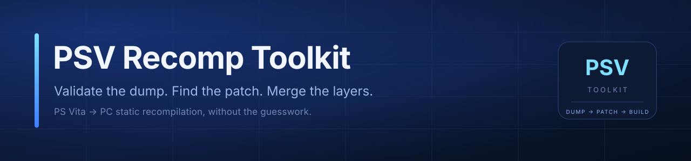
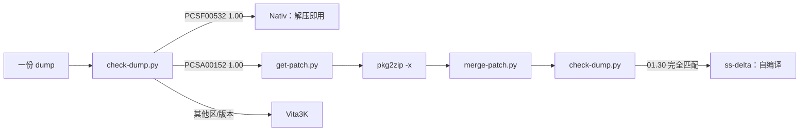

<p align="center">
  
</p>

<h1 align="center">PSV Recomp Toolkit</h1>

<p align="center">
  <em>先验材料，再谈重编译。查区码、找补丁、合更新层、选路线。</em>
</p>

<p align="center">
  <a href="https://github.com/kidnappe/psv-recomp-toolkit/actions/workflows/ci.yml"></a>
  <a href="LICENSE"></a>
  
  
  
</p>

<p align="center">
  <a href="README.md">English</a> | <a href="README.zh-CN.md">中文</a>
</p>

> **本仓库不包含任何游戏数据。** 没有游戏本体、补丁 pkg、固件、授权文件、解密资源或编译产物。请使用自己合法持有的副本。
>
> **这里也不是重编译器本身。** 它只负责判断 dump 能不能用、找官方补丁、把材料整理成重编译器要的形状。重编译器在 [vita-recomps/ss-delta](https://github.com/vita-recomps/ss-delta) 和 [Project Nativ](https://github.com/TheLostPantheon/nativ)。

## 目录

- [这是什么](#这是什么)
- [已知路线（示例）](#已知路线示例)
- [工具](#工具)
- [环境要求](#环境要求)
- [安装](#安装)
- [五分钟上手](#五分钟上手)
- [完整流程：美版《Soul Sacrifice Delta》合并到 1.30](#完整流程美版soul-sacrifice-delta合并到-130)
- [命令参考](#命令参考)
- [工作原理](#工作原理)
- [移植其他 PSV 游戏](#移植其他-psv-游戏)
- [兼容数据](#兼容数据)
- [美版的中文](#美版的中文)
- [常见问题](#常见问题)
- [文档](#文档)
- [目录结构](#目录结构)
- [范围与声明](#范围与声明)
- [参与贡献](#参与贡献)
- [致谢](#致谢)
- [许可](#许可)

## 这是什么

静态重编译工具认的是 **eboot 的 SHA-256 和 `APP_VER`**，不是文件夹名，也不是下载页的标题。区码选错，或者忘了 1.30 更新，工具链会在你装完 Visual Studio、Qt 和 Vulkan SDK 之后才拒绝这份 dump。

这个仓库处理它前面的四步：

| 问题 | 工具 |
|---|---|
| 这份 dump 是哪个区、哪个版本，能不能用？ | `check-dump.py` |
| 官方更新包在哪？ | `get-patch.py` |
| dump 分成 `app/` 和 `patch/`，怎么合？ | `merge-patch.py` |
| Vita3K 什么状态，有没有现成原生 pack？ | `psv-lookup.py` |

全部是 Python 标准库脚本。不需要 `pip install`，不需要编译，仓库里没有游戏数据。

这个工具集不绑定《Soul Sacrifice Delta》。它只是完整示例，因为这条路线记录得最全；脚本本身只关心一份 PS Vita dump 的结构、`TITLE_ID`、`APP_VER` 和更新层。

## 已知路线（示例）

| Title ID | 区 | Vita3K | 原生重编译 | 中文 |
|---|---|---|---|---|
| `PCSA00152` | 美 | Playable（graphics bug） | **ss-delta**，需 1.30 补丁 + 自编译 | ✅ 简中 / 繁中文本¹ |
| `PCSF00532` | 欧 | Playable（graphics bug） | **Nativ**，解压即用 | 未验证 |
| `PCSC00049` | 日 | Playable（graphics bug） | — | 日文 |
| `PCSD00079` | 亚洲 / 港 | **Ingame +**（graphics / shader bug） | —（需自建 pack） | ✅ 繁中 |
| `PCSA00092` | 美（2013 原版） | Playable | —（两个项目都只做 Delta） | — |

> Vita3K 的“Playable”是按同款最好的区汇总的；逐条看，亚洲版实际是 `Ingame +`。

`psv-lookup.py` 覆盖完整的 Vita3K 商业游戏列表和它认识的 Nativ pack；上表只是这个仓库围绕的路线，不是脚本的能力上限。见[移植其他 PSV 游戏](#移植其他-psv-游戏)。

¹ 美版 1.30 的 archive 里有 `_cn` / `_tw` 文本表和字体（`achievement_text_cn.msgt`、`elder_cn_font0.gxt`、`font_config_cn.csv` 等）。在 ss-delta 里设 `[game] language = chinese_s` 或 `chinese_t` 即可；本工具不修改游戏语言。

## 工具

| 脚本 | 作用 | 示例 |
|---|---|---|
| [`scripts/check-dump.py`](scripts/check-dump.py) | 读 `TITLE_ID`、`APP_VER`、eboot SHA-256，给出路线结论 | `python scripts/check-dump.py <dump目录>` |
| [`scripts/merge-patch.py`](scripts/merge-patch.py) | 把 `patch/` 覆盖进 `app/`，输出合并后的树 | `python scripts/merge-patch.py --app … --patch … --out …` |
| [`scripts/get-patch.py`](scripts/get-patch.py) | 查索尼公开更新接口，拿任意零售标题的补丁地址 | `python scripts/get-patch.py PCSA00152` |
| [`scripts/psv-lookup.py`](scripts/psv-lookup.py) | 按名字 / Title ID 查 Vita3K 状态和现成 pack | `python scripts/psv-lookup.py "Soul Sacrifice"` |

## 环境要求

- **Python 3.10+**
- 无第三方依赖
- 示例用 PowerShell；脚本本身支持 Windows、macOS、Linux
- 加密 `.pkg` 需要 [`pkg2zip`](https://github.com/lusid1/pkg2zip)（不随仓库分发）

## 安装

```powershell
git clone https://github.com/kidnappe/psv-recomp-toolkit.git
cd psv-recomp-toolkit
```

没有安装步骤。以下命令都在仓库根目录执行。

## 五分钟上手

```powershell
# 1. 这份 dump 是什么？
python scripts/check-dump.py "<dump目录>"

# 2. 有没有已知路线？
python scripts/psv-lookup.py "Soul Sacrifice Delta"
```

`check-dump.py` 的输出大致如下：

```
输入        : ...\PCSA00152
标题        : Soul Sacrifice™ Delta
Title ID    : PCSA00152
APP_VER     : 01.30
eboot 候选  :
     6998944 B  fa278b30c958187111f8b9face800d5c76c4bf5ec86a23fa0d35e6fcb04da3bf  ...\eboot.bin

结论        : ✅ 完全匹配 PCSA00152 1.30：走 vita-recomps/ss-delta …
```

看三行就能判断：

| 输出 | 含义 |
|---|---|
| `PCSF00532` + `APP_VER 01.00` | 欧版，Nativ 解压即用，最省事 |
| `PCSA00152` + `APP_VER 01.30` | 美版，可走 ss-delta，需自编译 |
| `PCSA00152` + `APP_VER 01.00` | 美版但补丁未合并，先走下面的流程 |
| `PCSD00079` / `PCSC00049` | 只能 Vita3K；原生这条路暂时到此为止 |

## 完整流程：美版《Soul Sacrifice Delta》合并到 1.30

### 1. 校验原始 dump

```powershell
python scripts/check-dump.py "D:\dumps\app\PCSA00152"
```

如果显示 `APP_VER 01.00`、eboot 哈希与 1.30 不符，说明需要补丁。

### 2. 查询官方补丁

```powershell
python scripts/get-patch.py PCSA00152
```

输出包含版本、大小、`content_id`、`sha1` 和直接下载地址。补丁免费，不需要 PSN 账号；`type="cumulative"` 表示累积更新，装最新的即可。

### 3. 解包补丁 pkg

```powershell
pkg2zip.exe -x PCSA00152-0130.pkg
```

patch 类型的 pkg **不需要 zRIF**。解出来的目录应类似 `patch\PCSA00152\…`。

### 4. 合并进本体

```powershell
# 默认只打印计划，不写文件
python scripts/merge-patch.py `
    --app   "D:\dumps\app\PCSA00152" `
    --patch "D:\dumps\patch\PCSA00152"

# 确认无误后写到新目录（推荐）
python scripts/merge-patch.py `
    --app   "D:\dumps\app\PCSA00152" `
    --patch "D:\dumps\patch\PCSA00152" `
    --out   "D:\dumps-merged\PCSA00152"
```

脚本会先核对两边的 `TITLE_ID`，不一致直接拒绝；默认期望补丁是 `01.30`，可用 `--expect-ver` 改。`--out` 指向的目录必须为空。

### 5. 复验合并结果

```powershell
python scripts/check-dump.py "D:\dumps-merged\PCSA00152"
```

应看到 `APP_VER 01.30` 和 `✅ 完全匹配`。

### 6. 交给重编译器

按 [ss-delta](https://github.com/vita-recomps/ss-delta) 的 README 安装工具链，
把上一步的目录作为 `install-game.py --install` 的输入。
安装/重编译还需要索尼固件 `PSVUPDAT.PUP`（setup 脚本会自动下载）。

## 命令参考

### check-dump.py

```powershell
python scripts/check-dump.py <目录 | .vpk | eboot> [--json]
```

- 支持 NoNpDrm 目录、`.vpk`、单个 eboot 文件；`.pkg` 请先用 pkg2zip 解开。
- 目录模式下会递归找 eboot 和 `param.sfo`，优先读 `app/` 层。
- `--json` 输出机器可读结果，方便接 CI 或批量脚本。
- 路径不存在时返回码为 `2`。

### get-patch.py

```powershell
python scripts/get-patch.py <TitleID> [--json]
```

- 例：`python scripts/get-patch.py PCSA00152`
- 无记录时返回 `1`（404），通常是 ID 写错或不是零售标题。

### merge-patch.py

```powershell
python scripts/merge-patch.py --app <目录> --patch <目录> [--out <目录> | --inplace] [--expect-ver 01.30]
```

- 默认空跑，只打印合并计划（前 20 项）。
- `--out`：复制本体到新目录再覆盖，推荐。
- `--inplace`：直接改本体，会先写 `merge-inplace-backup.txt` 作为回滚依据。
- 输出目录非空会拒绝执行，避免覆盖已有文件。

### psv-lookup.py

```powershell
python scripts/psv-lookup.py <名字片段 | TitleID>
python scripts/psv-lookup.py --region EU
```

- 模糊匹配游戏名，或直接查 Title ID。
- `--region` 列出该区有现成重编译支持的标题（支持 `EU/US/JP/AS` 简写）。
- 数据来自 `data/vita3k-compat.json`。

## 工作原理



补丁之所以要合并：NoNpDrm 的 dump 在 `ux0` 里是分层的（`app/`、`patch/`、`addcont/`），
Vita 挂载时 patch 覆盖 app 的同名文件；PC 侧重编译要的是一棵已经合并好的树。

## 移植其他 PSV 游戏

脚本不绑定《Soul Sacrifice Delta》。任何 PS Vita dump 都能检查和合并；变的是重编译那一侧。

| 情况 | 你要做什么 | 工作量 |
|---|---|---|
| 有对应 Title ID + 版本的 Nativ pack | 校验 dump、按 pack 要求合并补丁、用 Nativ | 几分钟到一小时 |
| ss-delta 支持 | 校验、合并 1.30、编译 ss-delta | 一次工具链构建 |
| 没有现成 pack | 新建 recomp 项目：`pack-init` / `bootstrap` / `hookmap`；工具仍负责校验和准备 dump | 几天到几周，看游戏 |
| 只能模拟器 | Vita3K | 几分钟 |

`check-dump.py` 内置的是 SSD 几个 SKU 的哈希；其他游戏仍会输出 `TITLE_ID`、`APP_VER` 和 eboot 哈希，但结论是“需人工判路线”，直到你把该游戏的已知哈希/版本加进 `TARGETS`。

## 兼容数据

`data/vita3k-compat.json` 是 Vita3K 官方兼容列表的落盘快照，约 3400 条。
数据过期后重新抓取：

```powershell
curl -L --compressed -o data/vita3k-compat.json https://api.vita3k.org/list/commercial
```

## 美版的中文

美版 1.30 不是纯英文。ss-delta 安装时会解密 archive，文件表里能看到 `_cn` 和 `_tw` 的文本与字体。语言在 `ss-delta.ini` 里设：

```ini
[game]
language = chinese_s   ; 简中；繁中用 chinese_t
```

游戏内按 `F1` → Game 页也能改，下次启动生效。只有想要 `PCSD00079` 这个 SKU 本身时，才需要亚洲版——它的原生 pack 仍需自建。

## 常见问题

**`✅ 完全匹配` 之后还要编译吗？**
要。本仓库只负责确认材料和准备输入，重编译本身由 ss-delta / Nativ 完成。

**合并后 eboot 哈希还是不对？**
确认补丁是同一个 Title ID、pkg2zip 完整解包、`--patch` 指向的是 `patch\<TID>` 这一层；
`addcont/` 不参与合并。

**想要中文，必须用亚洲版吗？**
不用。美版 1.30 的 archive 里带 `_cn` / `_tw` 文本和字体，
`ss-delta.ini` 设 `language = chinese_s`（简中）或 `chinese_t`（繁中），重启即可。
亚洲版原生仍没有现成 pack——只有想跑 `PCSD00079` 这个 SKU 本身时，
才需要自己用 Nativ 的 `pack-init` / `bootstrap` / `hookmap` 建，工作量是天级。

**`.pkg` 能直接校验吗？**
不能。pkg 是加密容器，先 `pkg2zip -x` 解成目录（本体需要 zRIF，patch 包不需要）。

**合并会改动原始 dump 吗？**
默认不会。不加 `--out` / `--inplace` 时只打印计划；`--out` 写新目录；`--inplace` 才覆盖本体。

**Windows 控制台中文/符号乱码？**
脚本已强制 UTF-8 输出。仍有问题的话用 Windows Terminal，或先 `chcp 65001`。

## 文档

- [`docs/dump-formats.md`](docs/dump-formats.md) — dump 形态与判据：区码、版本、格式、官方补丁接口
- [`docs/vita3k-setup.md`](docs/vita3k-setup.md) — Vita3K 从零到进游戏（Windows）

## 目录结构

```
.
├─ data/
│  └─ vita3k-compat.json
├─ docs/
│  ├─ assets/banner.svg
│  ├─ dump-formats.md
│  └─ vita3k-setup.md
├─ scripts/
│  ├─ check-dump.py
│  ├─ get-patch.py
│  ├─ merge-patch.py
│  └─ psv-lookup.py
├─ .github/workflows/ci.yml
├─ .gitattributes
├─ .gitignore
├─ LICENSE
├─ README.md
└─ README.zh-CN.md
```

## 范围与声明

本仓库**不含**游戏本体、补丁 pkg、固件、授权文件、解密资源或编译产物。
本地的 `dumps*/`、`patch-extract/`、`tools/`、`build/`、`dist/`、`ss-delta-src/` 等
均已在 `.gitignore` 中排除。

工具只处理你自己提供的本地文件，请使用自己合法持有的游戏副本。

Soul Sacrifice Delta、PlayStation、PS Vita 及相关名称与商标归各自权利人所有。
本项目与 Sony Interactive Entertainment 无关联，也不分发任何官方游戏内容。

## 参与贡献

- 遇到问题请附上 `check-dump.py --json` 的输出（记得删掉个人路径）。
- **不要**在 issue / PR 里上传游戏文件、补丁 pkg、固件或授权文件。
- 代码保持标准库、零依赖；提交前跑一遍 `python -m compileall scripts`。

## 致谢

- [vita-recomps/ss-delta](https://github.com/vita-recomps/ss-delta) — 美版静态重编译
- [Project Nativ](https://github.com/TheLostPantheon/nativ) 与 [Luufen 的 fork](https://github.com/Luufen/nativ) — 欧版 pack
- [Vita3K](https://vita3k.org/) — 参考模拟器与兼容数据
- [pkg2zip](https://github.com/lusid1/pkg2zip) — pkg 解包

## 许可

[MIT](LICENSE)。脚本和文档按原样提供，不附带任何担保。
